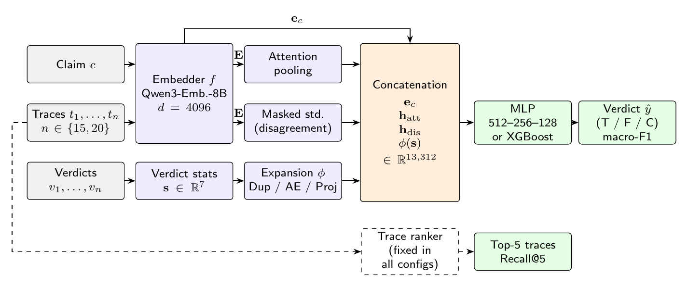
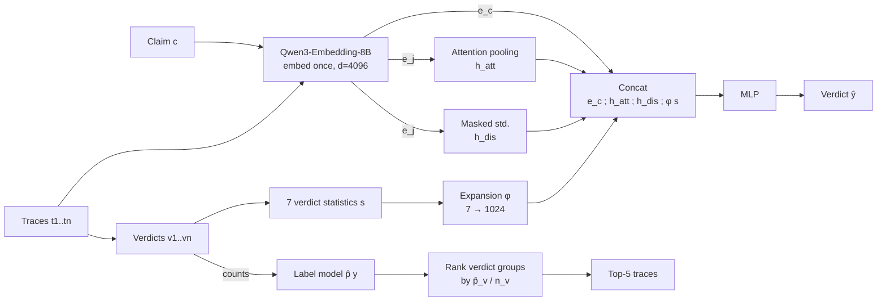

<h1 align="center">Automatic Numerical Fact Verification<br/>using Reasoning Traces</h1>

<p align="center">
  <strong>Verifying numerical claims and ranking LLM reasoning traces with embeddings, with no extra LLM calls.</strong><br />
  <i>Once an LLM has written its reasoning, do you need to call an LLM again to judge it?</i>
</p>

<div align="center">

[![Python][badge-python]](#reproducibility)
[![PyTorch][badge-pytorch]](#component-1-trace-aggregation-verifier)
[![scikit-learn][badge-sklearn]](#component-2-group-level-trace-ranker)
[![XGBoost][badge-xgboost]](#4-supervised-classification)
[![Qwen3-Embedding-8B][badge-qwen]](#architecture)
[![CLEF CheckThat! 2026][badge-clef]](#dataset-clef-checkthat-2026-task-2)

</div>

<p align="center">
  <a href="#tldr">Overview</a> ·
  <a href="#phase-1-exploring-reasoning-trace-representations">Exploration</a> ·
  <a href="#phase-2-the-final-embedding-only-system">Method</a> ·
  <a href="#results">Results</a> ·
  <a href="#ablations-macro-f1-on-the-test-set">Ablations</a> ·
  <a href="#my-contributions">My contributions</a> ·
</p>

<p align="center">
  
  
  
  
  <a href="https://github.com/medhairya/Automatic-Numerical-Fact-Verification-Using-Reasoning-Traces/commits/main"></a>
  <a href="https://github.com/medhairya/Automatic-Numerical-Fact-Verification-Using-Reasoning-Traces/stargazers"></a>
</p>



*The embedding-only pipeline. Claims and traces are embedded once with Qwen3-Embedding-8B. A trace-aggregation verifier (attention pooling, disagreement and verdict statistics into an MLP) predicts the verdict, and a group-level ranker picks the top-5 traces. No LLM is called at any stage.*

[badge-python]: https://img.shields.io/badge/Python-3776AB?style=for-the-badge&logo=python&logoColor=white
[badge-pytorch]: https://img.shields.io/badge/PyTorch-EE4C2C?style=for-the-badge&logo=pytorch&logoColor=white
[badge-sklearn]: https://img.shields.io/badge/scikit--learn-F7931E?style=for-the-badge&logo=scikitlearn&logoColor=white
[badge-xgboost]: https://img.shields.io/badge/XGBoost-189FDD?style=for-the-badge
[badge-qwen]: https://img.shields.io/badge/Qwen3--Embedding--8B-FFD21E?style=for-the-badge&logo=huggingface&logoColor=black
[badge-clef]: https://img.shields.io/badge/CLEF_CheckThat!-2026-6A5ACD?style=for-the-badge

## TL;DR

| | |
|---|---|
| **Task** | Given a numerical claim, its evidence, and 15–20 LLM reasoning traces: **(i)** predict the verdict and **(ii)** rank the traces by usefulness |
| **Approach** | Embed every claim and trace **once**, then solve both tasks with lightweight models (an MLP and logistic regression). **No LLM inference** |
| **Benchmark** | CLEF CheckThat! 2026 Task 2: English (QuanTemp, 3-class) and Arabic (binary) |
| **Arabic** | Macro-F1 **0.9771**, vs **0.8679** for the best leaderboard system. Still **0.9543 after removing train/test leakage** |
| **English** | Official score **0.4249**, within 0.004 of the #1 system (a QLoRA fine-tuned Llama-3.1-8B) |
| **Standing** | Would place **#1 in Arabic** and **#3 in English** against systems running 3B–27B LLMs on every trace |
| **Key insight** | How the trace verdicts are spread, and how much the traces disagree, carries most of the signal |

---

## Why numerical fact verification is hard

Most online misinformation contains inaccurate numbers or misleading temporal information. Numbers give a statement an unearned air of precision; this is known as the **numeric-truth effect**. Numerical claims are also measurably harder to verify than non-numerical ones.

Consider:

> *"Country X's exports increased by 37% between 2019 and 2022."*

A semantic-similarity system can retrieve highly relevant evidence, with the same entities, concepts and terminology, and still fail to determine:

- whether the reported percentage is correct,
- whether the time period is correct,
- whether the comparison is calculated correctly,
- whether the evidence actually supports the numerical statement.

Verifying such a claim needs **exact quantitative reasoning, arithmetic, comparisons, temporal grounding and evidence interpretation**. A response can be semantically plausible and still numerically wrong. This is the gap between **semantic plausibility** and **numerical correctness**.

---

## The idea: reasoning traces are data, not just explanations

Current LLM fact-checking systems mostly focus on evidence: finding it and reasoning over it. The final verdict usually comes from:

- a **majority vote** over several sampled reasoning traces (self-consistency), or
- a **trained or LLM-based verifier** that scores each sample, at the cost of more LLM inference, compute and time.

Sampling an LLM several times leaves behind much more than a vote, though. It leaves a **set of reasoning traces** whose content, mutual agreement and verdict distribution all carry information.

**Core hypothesis:**

> Multiple reasoning traces generated for the same numerical claim contain complementary semantic and structural information about claim veracity, and this information can be learned from their representations.

Rather than asking only *"What does the claim say?"*, this project asks:

> **"What does the model's reasoning about the claim look like, and can that structure predict whether the claim is correct?"**

### Design principles

1. **Embeddings instead of LLM inference.** Every claim and trace is embedded once. Both tasks are solved by lightweight models.
2. **A unified multilingual framework.** One multilingual embedding model and one architecture for every language. Only the hyperparameters are tuned per language.
3. **Traces, not just final answers.** The verifier looks at how verdicts are spread out, how much traces disagree, and what each trace says.

---

## Problem formulation

Each claim $c$ comes with evidence passages $E$ and $n$ reasoning traces $T = \{t_1, \dots, t_n\}$, generated from $(c, E)$ at different sampling temperatures. Every trace $t_j$ ends in a verdict $v_j$, and every claim has a gold label $y \in \mathcal{Y}$:

- **English:** $\mathcal{Y} = \{\text{True}, \text{False}, \text{Conflicting}\}$
- **Arabic:** $\mathcal{Y} = \{\text{True}, \text{False}\}$

Given $(c, E, T)$, the system must predict a label $\hat{y}$ **and** produce an ordering of the traces.

- **Verification** is scored with **macro-F1**.
- **Ranking** is scored with **Recall@5**. A trace is *relevant* if its verdict matches the gold label ($v_j = y$), so the relevant set is $R = \{t_j \in T : v_j = y\}$. Claims with no relevant traces score 0.
- **Official score** = mean of macro-F1 and Recall@5.

---

## Project roadmap

The work happened in two phases. Phase 1 explored what lives in reasoning-trace embedding space. Its findings directly shaped the final system built in Phase 2.

```text
Phase 1: Exploration                          Phase 2: Final system
────────────────────                          ─────────────────────
CheckThat! 2025 + 2026 claim matching         CheckThat! 2026 (EN + AR)
134k-embedding corpus (BGE / Qwen3 / F2LLM)   Qwen3-Embedding-8B (d = 4096)
Embedding geometry (SVD, centroids, clusters) Trace-aggregation verifier (MLP)
MLP + XGBoost classifiers                     Group-level trace ranker (LogReg)
Feature ablations                             Leakage-aware evaluation + ablations
        │                                                  ▲
        └──── "raw embeddings don't separate;  ────────────┘
               aggregation and verdict encoding matter"
```

---

# Phase 1: Exploring reasoning-trace representations

## Dataset and corpus

Numerical claims from **CLEF CheckThat! 2025 and 2026**.

| Metric | Value |
|---|---:|
| Total claims | **10,558** |
| Semantically matched claims (2025 ↔ 2026) | **6,469** |
| Reasoning-trace embeddings | **128,085** |
| Total dense embeddings | **134,554** |
| Embedding dimensionality (BGE) | **1024** |
| Verification classes | **True / False / Conflicting** |

## Experimental components

### 1. Semantic overlap analysis
I identified semantically related claims across the CheckThat! 2025 and 2026 datasets. This gives a basis for checking whether similar numerical claims produce similar reasoning representations across datasets.

### 2. Reasoning-trace embedding
Multiple LLM-generated reasoning traces per claim were embedded into dense vectors.

| Role | Model |
|---|---|
| Primary embedding model | **BGE-large-en-v1.5** |
| Robustness comparisons | **Qwen3-Embedding-8B**, **F2LLM-v2-4B** |

### 3. Embedding geometry
Do veracity classes naturally occupy distinguishable regions of embedding space? I analysed:

- Singular Value Decomposition (SVD) and dimensional analysis
- Centroid distances
- Inter-class and intra-class distances
- Pairwise similarity
- Cluster structure and class separation

### 4. Supervised classification

| Model | Role |
|---|---|
| **MLP** | Non-linear representation classifier |
| **XGBoost** | Tree-based classifier for engineered representations |

### 5. Ablation studies
Feature groups were removed one at a time to find out which signals actually matter:

- Claim-only representations
- Reasoning-trace representations
- Claim–trace relationships
- Attention-based aggregation
- Disagreement features
- Verdict representations
- Aggregated representations

The goal was not just to maximise accuracy, but to understand **which properties of reasoning traces are useful for verification**.

## Phase 1 findings

- **Reasoning traces carry information beyond the claim.** Trace representations provide signals the claim embedding alone doesn't capture.
- **Raw embedding space is not enough.** Veracity classes don't cleanly separate in raw embeddings, which motivates feature engineering and learned aggregation over plain similarity.
- **Aggregation matters.** How multiple traces are combined strongly affects downstream performance. Attention-based aggregation lets the model weight traces differently.
- **XGBoost is a strong baseline.** It performs competitively on engineered features, so the signal lives in a fairly structured feature space without needing an end-to-end neural model.
- **Verdict representation matters.** How the traces' categorical verdicts are encoded substantially changes classification results.
- **Geometry shows non-trivial structure.** Traces have structure with respect to veracity, which motivated **trace-level selection and ranking**. That became the second task of the final system.

---

# Phase 2: The final embedding-only system

## Dataset: CLEF CheckThat! 2026 Task 2

Each claim comes with **20 traces**, except **196 English train/validation claims**, which have **15**.

| | English | | | | Arabic | | |
|---|---:|---:|---:|---:|---:|---:|---:|
| **Split** | True | False | Conflicting | **Total** | True | False | **Total** |
| Train | 1,175 | 3,717 | 1,508 | 6,400 | 1,164 | 1,444 | 2,608 |
| Validation | 304 | 913 | 383 | 1,600 | 291 | 361 | 652 |
| Test | 520 | 1,783 | 255 | 2,558 | 193 | 318 | 511 |
| Train (dedup) | – | – | – | – | 1,010 | 1,381 | 2,391 |
| Validation (dedup) | – | – | – | – | 243 | 321 | 564 |

### Data leakage audit (Arabic)

While auditing the Arabic data I found two problems:

- **116 of 511** test claims repeat within the test set itself.
- **193 test claims (38%)** appear **word for word** in the training or validation data.

So every Arabic result is reported in two settings:

| Setting | Description |
|---|---|
| **Original** | Released splits, directly comparable to the official leaderboard |
| **Deduplicated** | Test set unchanged; overlapping claims removed from train/validation |

English has no train/val–test overlap, so deduplication applies to Arabic only.

## Architecture



Two components share one set of embeddings: a **trace-aggregation verifier** and a **group-level trace ranker**. No LLM is called at any stage.

## Component 1: Trace-aggregation verifier

**Embedding.** Claim: $e_c = f(c)$. Trace: $e_j = f(t_j)$, both in $\mathbb{R}^{4096}$. Trace embeddings are zero-padded to $N = 20$, and a mask $m_j \in \{0, 1\}$ marks real traces so padding never enters any summary.

**Attention pooling (which traces matter?).** A small scoring network gives each real trace a score. A softmax turns the scores into weights:

$$
\alpha_j = \frac{m_j \exp\left(w^\top \tanh(V e_j + b)\right)}{\sum_k m_k \exp\left(w^\top \tanh(V e_k + b)\right)}, \qquad h_{att} = \sum_j \alpha_j e_j
$$

with $V \in \mathbb{R}^{256 \times 4096}$, $b \in \mathbb{R}^{256}$ and $w \in \mathbb{R}^{256}$, all learned jointly with the classifier.

**Disagreement vector (do the traces agree?).** Attention tells you which traces are important, but not whether they agree. $h_{dis}$ is the **masked element-wise standard deviation** of the trace embeddings. Tightly clustered traces suggest an easier claim.

**Verdict statistics $s \in \mathbb{R}^7$:**

| # | Feature |
|---|---|
| 1–3 | Proportion of traces voting True / False / Conflicting |
| 4 | Majority fraction (how dominant the top verdict is) |
| 5 | Number of distinct verdicts |
| 6 | Entropy of the vote shares |
| 7 | Number of traces with a parsable verdict |

**Verdict expansion φ.** The 7 statistics are only **0.06%** of the input, so the network can easily ignore them. I widen them to 1024 dimensions in one of three ways, with the raw vector kept as a reference:

| Variant | Method |
|---|---|
| **Raw-7** | Unexpanded 7-dim vector (reference) |
| **Dup** | Cyclic duplication to 1024 dims |
| **AE** | Separately trained autoencoder (7–256–1024–256–7) |
| **Proj** | Learned projection (7–256–1024) |

**Classifier.** The input $[e_c;\ h_{att};\ h_{dis};\ \phi(s)] \in \mathbb{R}^{13{,}312}$ goes into:

| Setting | Value |
|---|---|
| MLP layers | 512 → 256 → 128 |
| Regularisation | Batch norm, ReLU, dropout 0.3 |
| Loss | Class-weighted cross-entropy |
| Optimiser | Adam, learning rate $10^{-3}$ |
| Batch size | 16 |
| Stopping | Early stopping on validation loss |

## Component 2: Group-level trace ranker

### Key observation
The scorer counts a trace as relevant when its verdict equals the gold label, so **all traces sharing a verdict are equally relevant**. For one claim, let:

- $n_v$ = number of traces with verdict $v$,
- $k_v$ = number of those placed in the top five ($\sum_v k_v = 5$, $0 \le k_v \le n_v$),
- $p_v$ = probability that the gold label is $v$.

Since Recall@5 $= k_y / n_y$ for gold label $y$:

$$
\mathbb{E}[\text{Recall@5}] = \sum_{v:\ n_v > 0} p_v \frac{k_v}{n_v}
$$

### Optimal ranking rule
> **Expected Recall@5 is maximised by filling the top five slots with verdict groups in decreasing order of $p_v / n_v$.**

*Proof.* The objective is linear in $k$. Each slot given to group $v$ adds $p_v / n_v$, independently of the other slots, for at most $n_v$ slots. Filling slots greedily by largest $p_v / n_v$ is therefore optimal. □

Consequences:

- Only **how many** traces come from each verdict group matters, not which ones.
- **Small groups are favoured** when probabilities are comparable. One slot recovers half of a 2-trace group, but only a tenth of a 10-trace group.
- A ranker that scores each trace on its own ignores group size. Performance therefore depends on **calibrated estimates of $p_v$**.

### Estimating $p_v$
A **logistic regression** on verdict-count features: $n_v / n$, $\log(1 + n_v)$, and $\mathbb{I}[n_v = 0]$.

Extra feature blocks are added **only if they improve 5-fold cross-validated Recall@5** on train + validation:

| Candidate block | Selected on |
|---|---|
| 32-dim PCA of the claim embedding (from 4096) | – |
| Similarity-weighted labels of the 10 nearest training claims | Original data |
| Summaries of each verdict group's trace embeddings | Deduplicated Arabic |

**Within a group**, traces are ordered by cosine similarity to the group centroid.

**Training-copy prior.** If a test claim also occurs in training (after whitespace and case normalisation), $\hat{p} \leftarrow 0.9\,q + 0.1\,\hat{p}$, where $q$ is the label distribution of its training copies. This uses only training labels, so it also works in the deduplicated setting.

---

## Results

Official score = mean of macro-F1 and Recall@5. Organisers' baselines: **0.4175** (EN), **0.2963** (AR).

| Lang | System | Backbone (per trace) | Score | Macro-F1 | Recall@5 |
|---|---|---|---:|---:|---:|
| EN | ahmadraza123 (#1) | Llama-3.1-8B, QLoRA | 0.4286 | 0.6150 | 0.2421 |
| EN | VeriFind (#2) | Llama-3.2-3B, LoRA | 0.4261 | 0.5988 | 0.2534 |
| EN | **This project** | **Embeddings only** | **0.4249** | **0.5971** | **0.2527** |
| EN | GOS-DSGT (#3) | n/d | 0.4234 | 0.6002 | 0.2466 |
| AR | **This project** | **Embeddings only** | **0.6585** | **0.9771** | **0.3399** |
| AR | **This project (dedup)** | **Embeddings only** | **0.6445** | **0.9543** | **0.3348** |
| AR | CheckMates (#1) | 3B + 27B LLM judge | 0.6043 | 0.8679 | 0.3406 |
| AR | team-outsider (#2) | n/d | 0.6004 | 0.8583 | 0.3426 |
| AR | mircean2 (#3) | n/d | 0.5992 | 0.8602 | 0.3382 |

- **Arabic:** ahead of #1 on macro-F1, with Recall@5 on par. Even after deduplicating train/validation, macro-F1 stays at **0.9543**, well above the leaderboard best of 0.8679.
- **English:** essentially tied with the top three systems, all of which run 3B–8B LLMs on every trace.

## Ablations: macro-F1 on the test set

"–" = not run. dd = deduplicated (ranker refitted).

| Features | EN Raw-7 | EN Dup | EN AE | EN Proj | AR Raw-7 | AR Dup | AR AE | AR Proj | AR-dd Raw-7 | AR-dd Dup | AR-dd AE | AR-dd Proj |
|---|---:|---:|---:|---:|---:|---:|---:|---:|---:|---:|---:|---:|
| ***All 20 traces*** | | | | | | | | | | | | |
| Full | .5075 | .5571 | .5613 | .5733 | .9711 | .9530 | .9550 | .9651 | .9380 | .9423 | .9488 | .9523 |
| No Attention | – | **.5971** | .5779 | .5253 | – | .9568 | .9588 | **.9771** | – | .9275 | .9339 | .9433 |
| No Disagreement | – | .5810 | .5714 | .5361 | – | .9450 | .9571 | .9631 | – | **.9543** | .9422 | .9385 |
| ***Top-5 ranked traces*** | | | | | | | | | | | | |
| Full | .5394 | .5366 | .5644 | .5806 | .9651 | .9571 | .9510 | .9570 | .9379 | .9362 | .9422 | .9266 |
| No Attention | – | .5620 | .5238 | .5595 | – | .9407 | .9586 | .9647 | – | .9334 | .9416 | .9392 |
| No Disagreement | – | .5692 | .5711 | .5738 | – | .9489 | .9430 | .9569 | – | .9299 | .9177 | .9311 |
| *Best leaderboard* | | .6150 | | | | .8679 | | | | – | | |

### What the ablations show

- **Verdict encoding is a big lever.** In English, expanding the 7 statistics with a learned projection lifts the Full model from **0.5075 (Raw-7) to 0.5733**.
- **Disagreement is the key signal in English.** With the Proj encoding, removing it drops macro-F1 from 0.5733 to 0.5361.
- **Attention is not always needed.** The best English (0.5971, Dup) and Arabic (0.9771, Proj) scores both come from the variants *without* attention pooling. The vote distribution and disagreement carry most of the signal.
- **Arabic is robust to component choice.** All original-data scores with all traces fall within ~3.2 points of each other.
- **Every deduplicated Arabic model** scores between **0.9177 and 0.9543**, above the original Arabic leaderboard best of 0.8679.
- **Top-5 vs all 20 traces.** English is nearly unchanged (Full Proj: 0.5733 → 0.5806). Arabic loses about a point (Full Proj: 0.9651 → 0.9570; Full AE dd: 0.9488 → 0.9422). Overall, keeping all 20 traces is safer: trace selection trades redundancy against complementary evidence and disagreement signal.

---

## Key takeaways

1. **No extra LLM call is needed** to verify a numerical claim or rank its traces once the traces exist. One embedding pass, a small MLP and a logistic regression compete with systems running 3B–27B LLMs per trace.
2. **The signal lives in the distribution of traces**: how verdicts split and how much the traces disagree, not just in any single trace.
3. **Small features need room to be heard.** Expanding 7 verdict statistics to 1024 dimensions changes results substantially.
4. **Ranking is a calibration problem.** Because relevance is defined per verdict group, the optimal ranker orders groups by $p_v / n_v$, and good probability estimates matter more than per-trace scoring.
5. **Evaluate honestly.** A 38% train/test overlap can inflate results. Reporting a deduplicated setting shows the gains hold up.

---

## My contributions

<!-- Edit to reflect your exact role -->

- Designed and implemented the **end-to-end embedding-only pipeline**: data loading, embedding, feature construction, training and evaluation
- Built the **134,554-embedding corpus** and ran **cross-year semantic claim matching** (6,469 matched claims across CheckThat! 2025 and 2026)
- Ran the **embedding-geometry study** (SVD, centroids,
